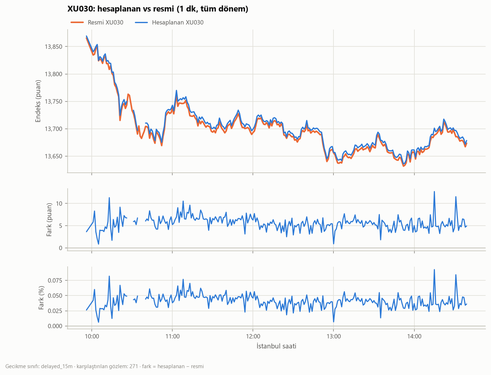
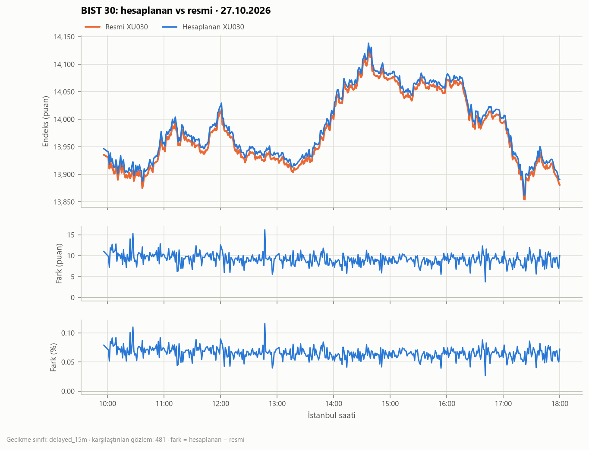
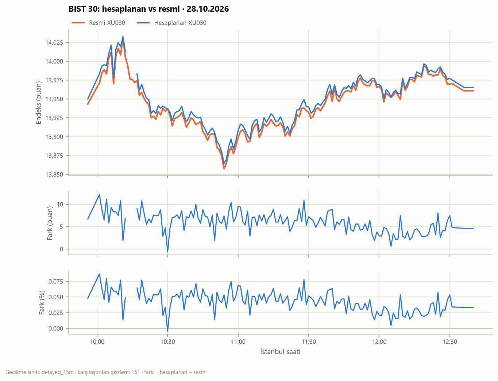
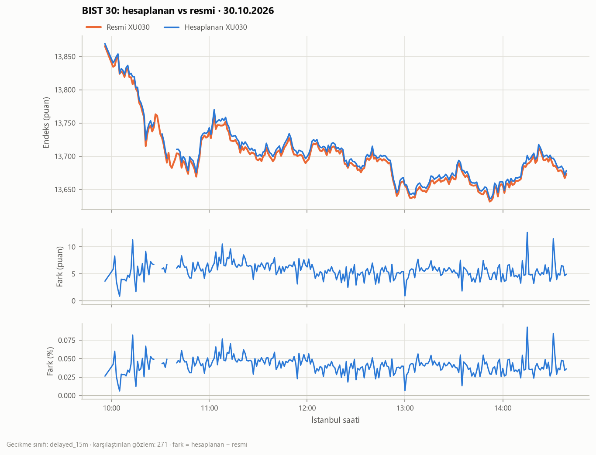
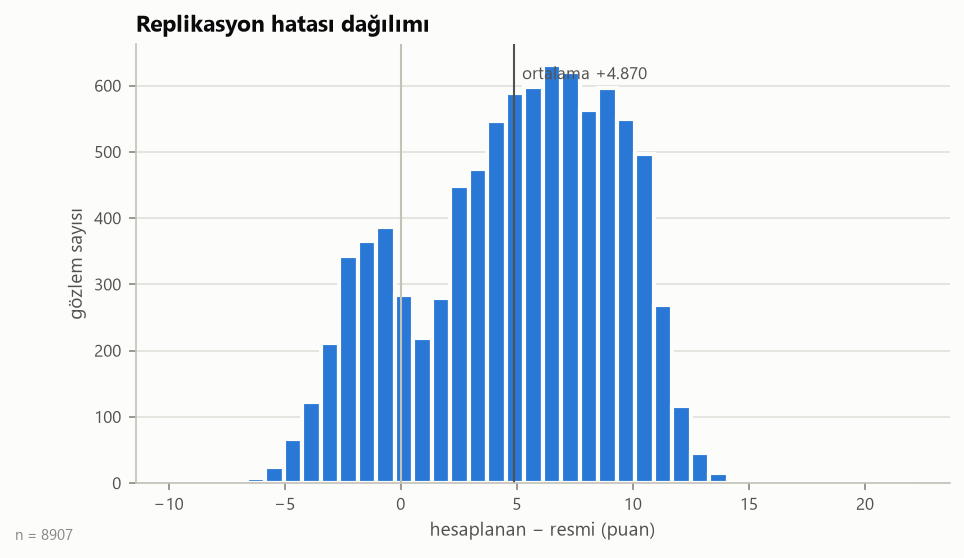
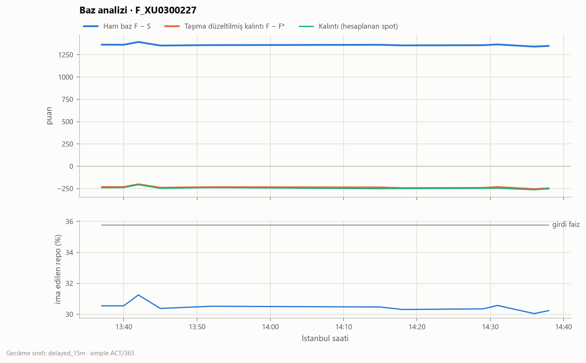
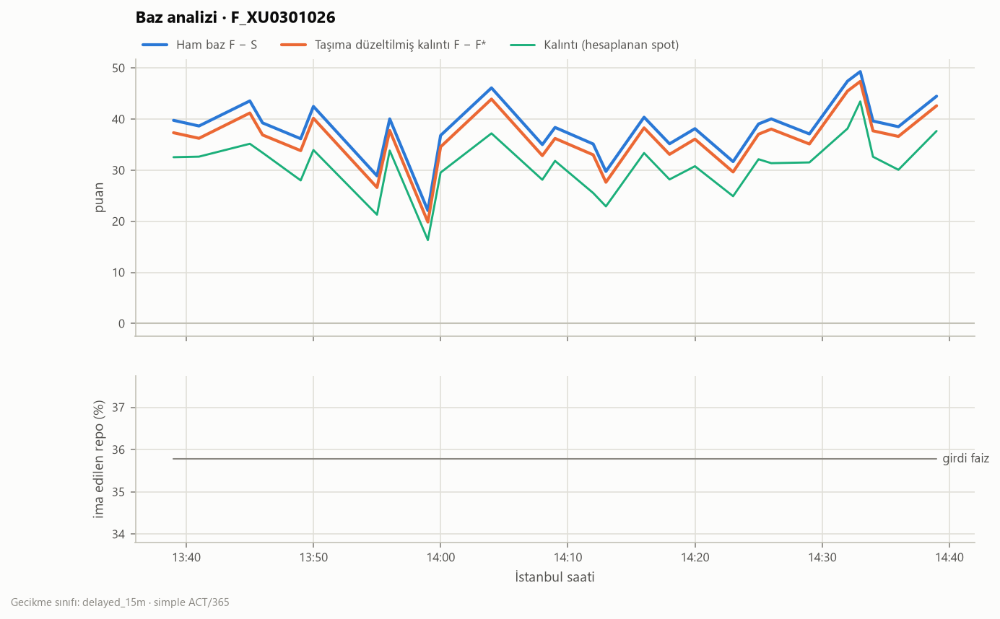
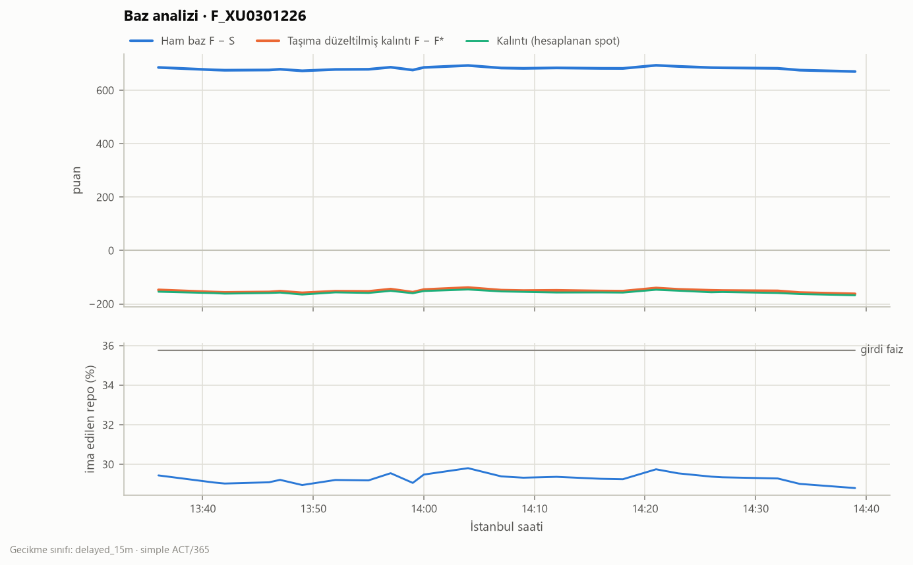

# BIST 30 Replikasyon ve VİOP Analizi — Özet

_Oluşturma: 2026-10-30 14:54 (İstanbul)_

## 1. Replikasyon metrikleri (hesaplanan − resmi, aynı market_ts)

| Alan | Değer |
|---|---|
| Dönem (UTC) | 2026-10-02 06:56:00+00:00 → 2026-10-30 11:39:00+00:00 |
| Gecikme sınıfı | delayed_15m |
| Fiyat kaynağı / resmi kaynak | yahoo / yahoo |
| Toplam / geçerli / karşılaştırılan | 9087 / 8907 / 8907 |
| Geçerli gözlem oranı | %98,0 |

| Metrik | Puan | % |
|---|---|---|
| MAE | 5,608 | 0,0388 |
| RMSE | 6,534 | 0,0457 |
| Medyan mutlak hata | 5,460 | 0,0370 |
| 95. yüzdelik mutlak hata | 10,950 | 0,0781 |
| Maks. mutlak hata | 22,050 | 0,1566 |
| Sapma (bias, ortalama işaretli) | 4,870 | 0,0340 |

| İzleme hatası | Değer |
|---|---|
| Getiri sayısı | 8887 |
| Gözlem başına izleme hatası (bp) | 1,452 |
| Getiri korelasyonu | 0,97364 |
| Yıllık izleme hatası (günlük kapanış, %) | 0,378 |

**Geçersiz gözlem nedenleri**

| Neden | Adet |
|---|---|
| stale>300s | 179 |
| price_jump>10% | 1 |

| Bayatlık (staleness) | Değer |
|---|---|
| Bayat bileşen içeren satır oranı | %2,2 |
| Ortalama / maks. bayat bileşen | 0,09 / 30 |
| Maks. bayatlık medyan / p95 / maks (sn) | 0 / 60 / – |
| En sık bayat hisseler | ASTOR (60), ASELS (36), SASA (34), TRALT (34), TRMET (34) |

**Gün bazında**

| date | n_total | n_compared | pct_valid | mae_pts | rmse_pts | max_abs_pts | bias_pts | mae_pct | te_per_obs_bps |
|---|---|---|---|---|---|---|---|---|---|
| 2026-10-02 | 481 | 481 | 100,000 | 2,065 | 2,532 | 9,180 | -1,820 | 0,014 | 1,534 |
| 2026-10-05 | 481 | 473 | 98,337 | 1,616 | 2,155 | 9,410 | -1,109 | 0,010 | 1,411 |
| 2026-10-06 | 481 | 477 | 99,168 | 2,445 | 2,738 | 8,120 | 2,348 | 0,016 | 1,259 |
| 2026-10-07 | 481 | 458 | 95,218 | 3,684 | 3,979 | 12,430 | 3,610 | 0,024 | 1,419 |
| 2026-10-08 | 481 | 481 | 100,000 | 3,973 | 4,247 | 14,280 | 3,944 | 0,026 | 1,348 |
| 2026-10-09 | 481 | 476 | 98,960 | 2,171 | 2,657 | 9,820 | -1,387 | 0,014 | 1,543 |
| 2026-10-12 | 481 | 481 | 100,000 | 1,729 | 2,115 | 7,800 | -1,511 | 0,012 | 1,155 |
| 2026-10-13 | 481 | 481 | 100,000 | 3,054 | 3,499 | 15,520 | 2,947 | 0,020 | 1,358 |
| 2026-10-14 | 481 | 481 | 100,000 | 4,988 | 5,141 | 11,310 | 4,988 | 0,033 | 1,140 |
| 2026-10-15 | 481 | 481 | 100,000 | 6,859 | 6,991 | 12,110 | 6,856 | 0,046 | 1,222 |
| 2026-10-16 | 475 | 469 | 98,737 | 6,686 | 6,944 | 18,970 | 6,674 | 0,046 | 1,830 |
| 2026-10-19 | 481 | 468 | 97,297 | 7,345 | 7,581 | 19,320 | 7,338 | 0,051 | 1,521 |
| 2026-10-20 | 481 | 481 | 100,000 | 6,952 | 7,151 | 12,190 | 6,948 | 0,048 | 1,453 |
| 2026-10-21 | 481 | 477 | 99,168 | 9,233 | 9,391 | 15,740 | 9,233 | 0,063 | 1,321 |
| 2026-10-22 | 481 | 466 | 96,881 | 9,455 | 9,596 | 22,050 | 9,455 | 0,066 | 1,432 |
| 2026-10-23 | 481 | 401 | 83,368 | 9,948 | 10,136 | 20,380 | 9,948 | 0,073 | 1,886 |
| 2026-10-26 | 481 | 472 | 98,129 | 10,239 | 10,367 | 15,310 | 10,239 | 0,074 | 1,676 |
| 2026-10-27 | 481 | 481 | 100,000 | 9,175 | 9,278 | 16,190 | 9,175 | 0,066 | 1,356 |
| 2026-10-28 | 155 | 151 | 97,419 | 5,996 | 6,402 | 12,150 | 5,987 | 0,043 | 1,902 |
| 2026-10-30 | 280 | 271 | 96,786 | 5,633 | 5,837 | 12,700 | 5,633 | 0,041 | 1,417 |

## 2. Veri gecikmesi (received_ts − market_ts)

| source | latency_class | received_col | n | n_live | n_backfill | delay_min_s | delay_median_s | delay_p95_s | delay_max_s |
|---|---|---|---|---|---|---|---|---|---|
| yahoo | delayed_15m | first_received_ts | 284 | 105 | 179 | 868,1 | 892,1 | 3.268,2 | 3.580,2 |
| foreks | delayed_15m | received_ts | 96 | 96 | 0 | 900,0 | 914,6 | 1.229,6 | 1.360,6 |
| foreks_list | delayed_15m | received_ts | 62 | 62 | 0 | 899,9 | 905,8 | 1.105,8 | 1.166,6 |

_Not: 1 saatten uzun gecikmeler geçmişe dönük doldurma (backfill) sayılır ve canlı istatistiklere girmez._

## 3. Baz ve adil değer

| Seri | Ortalama | Std | Min | Maks | n |
|---|---|---|---|---|---|
| Ham baz F − S (puan) | 681,7146 | 5,9514 | 670,4805 | 693,7100 | 24 |
| Kalıntı F − F* (puan) | -150,9851 | 5,6003 | -162,2698 | -138,7088 | 24 |
| Kalıntı (bp) | -110,4699 | 4,1339 | -118,6745 | -101,5966 | 24 |
| İma edilen repo (yıllık) | 0,2929 | 0,0024 | 0,2880 | 0,2981 | 24 |
| Kalıntı farkı: hesaplanan − resmi spot | -5,5128 | 1,2076 | -7,9250 | -3,6918 | 24 |

## 5. Deneylerin fizibilitesi

| Deney | Durum | Gerekçe |
|---|---|---|
| Replikasyon (hesaplanan vs resmi XU030) | yapılabilir | – |
| Adil değer (taşıma maliyeti) | yapılabilir | – |
| Baz / kalıntı / ima edilen repo | yapılabilir | – |
| Lead-lag (çapraz korelasyon) | yapılabilir | – |
| Fiyat keşfi (Hasbrouck/Gonzalo-Granger lite) | yapılabilir | – |
| Emir defteri dengesizliği → sonraki orta fiyat | **yapılamaz** | requires free depth data (no free, permitted BIST/VİOP depth source identified); yalnızca sentetik veride test edildi |
| Vade sonu uzlaşma fiyatı replikasyonu | yapılabilir | yaklaşık: 1 dk bar ile TWAP (borsa saniye bazlı endeks değerlerini kullanır) |
| Günlük uzlaşma fiyatı replikasyonu | **yapılamaz** | VİOP işlem bazlı (tick) veri yok; ücretsiz kaynak bulunamadı |

## 6. Grafikler

### intraday_all

### intraday_2026-10-27

### intraday_2026-10-28

### intraday_2026-10-30

### error_hist

### basis_F_XU0300227

### basis_F_XU0301026

### basis_F_XU0301226

## Notlar

- Bölen bir kez kalibre edildi: 2026-10-01 resmi kapanış, B=193508447.50316417.
- Gün sonu (EOD) testi 19 gün: MAE 5.81 puan, ortalama mutlak %0.0402, maks %0.0808.
- Yahoo 1 dk verisinde kapanış seansı fiyatı yok (son bar 17:59); EOD testi günlük kapanışla yapılır.
- Tüm gün içi veriler 15 dk gecikmeli (delayed_15m); gerçek zamanlı veriyle karıştırılmadı.

